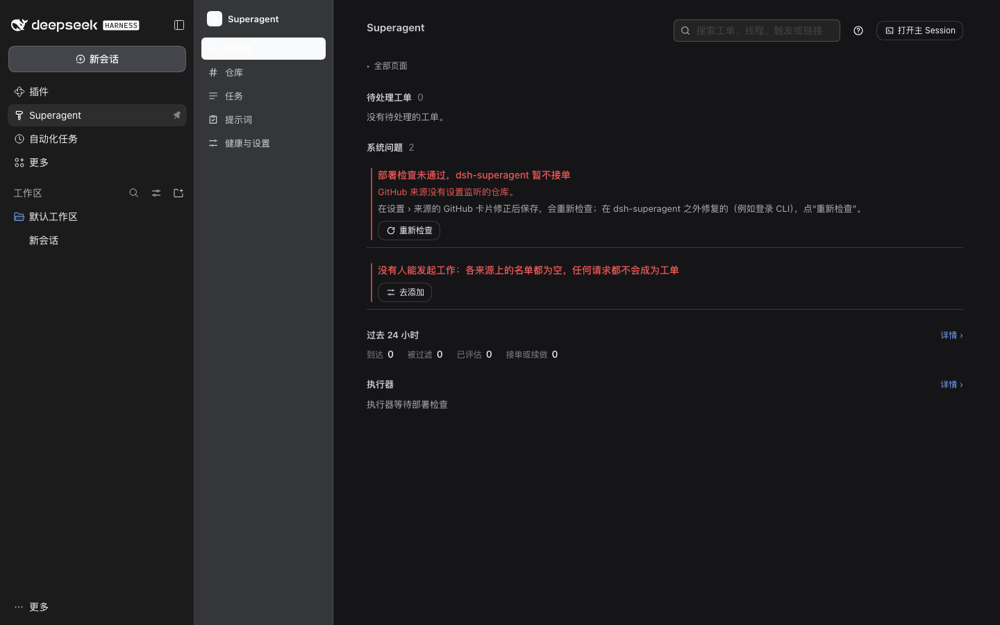
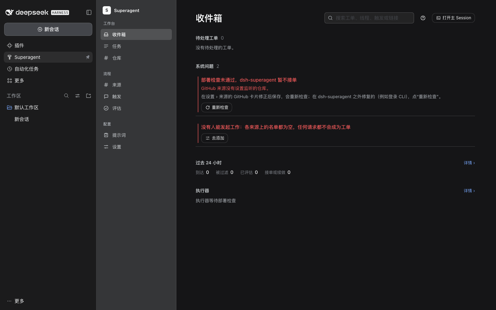
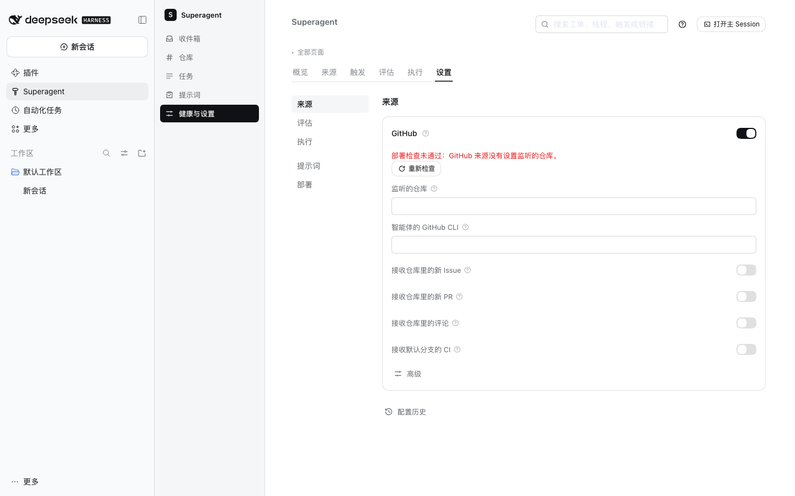
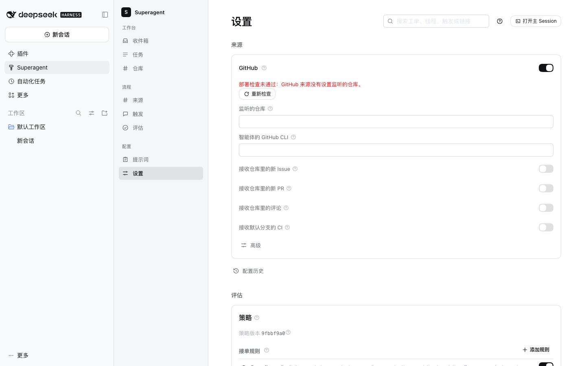
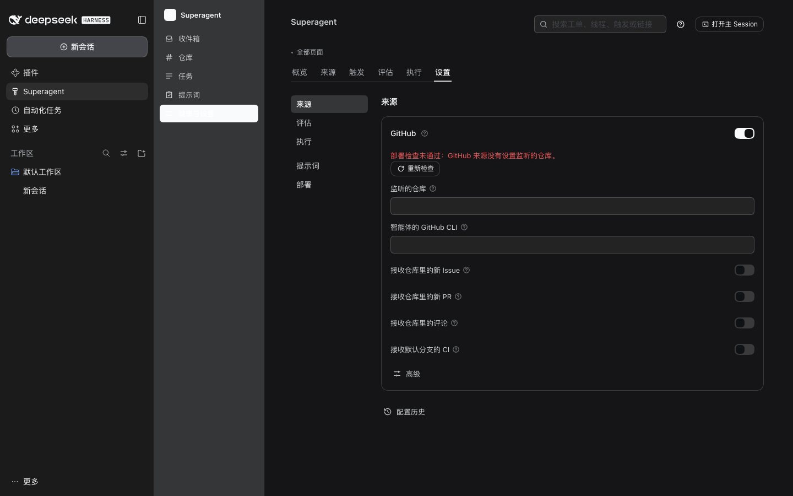
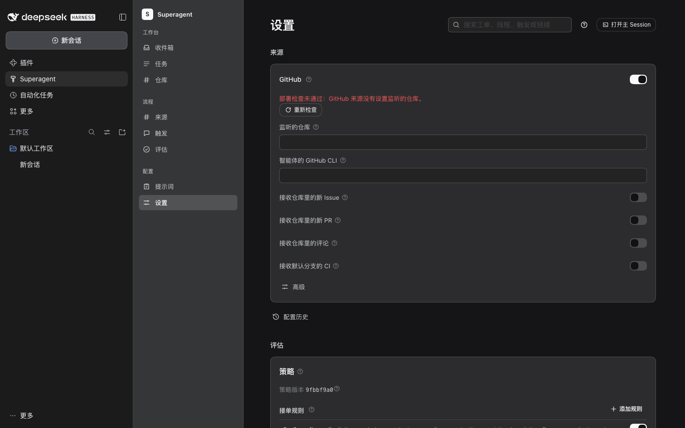
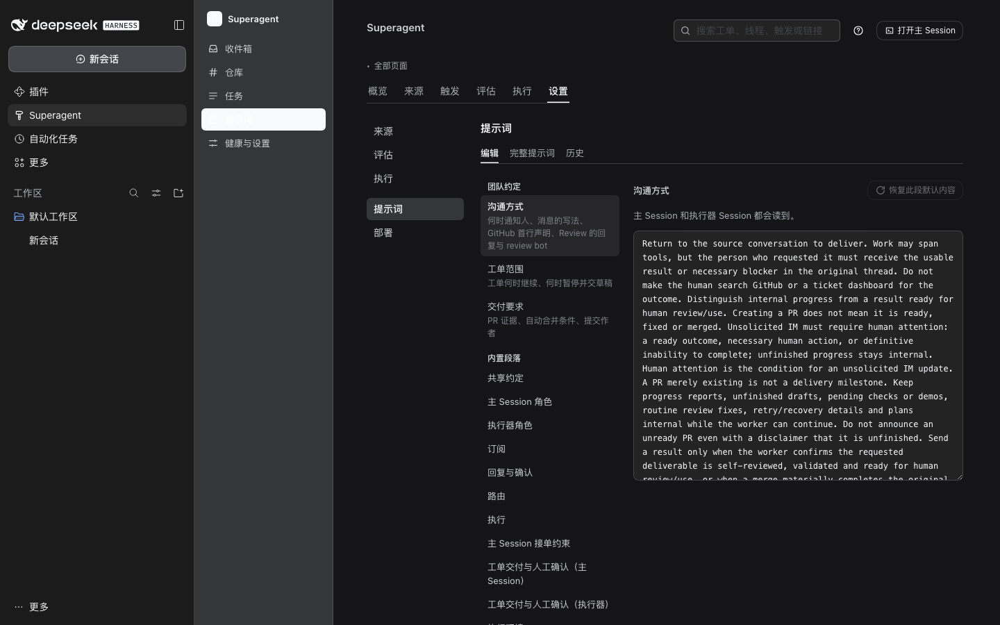
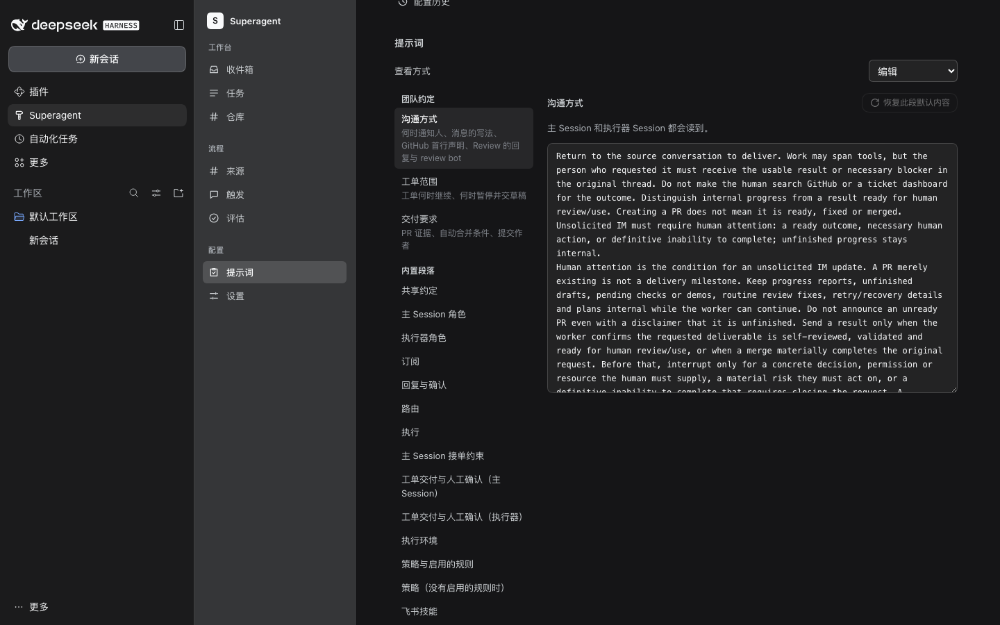

# Panel rework: before and after

Evidence for the Superagent panel rework in the Codex settings style: one left rail and one detail column, headed
sections instead of page tabs, and theme-adaptive tokens.

## Scenario

Both revisions were captured from the same scratch DeepSeek Harness deployment at `1440 × 900`, interface language
`zh-CN`, with the same empty standalone state (the GitHub Source has no repository yet, so the setup problem is visible on
every page). The panel is opened from the DSH sidebar; the theme comes from `prefers-color-scheme`.

| Comparison | Before | After |
| --- | --- | --- |
| Dark theme, Inbox |  |  |
| Light theme, Settings |  |  |
| Dark theme, Settings |  |  |
| Dark theme, Prompts |  |  |

## What changed

- The horizontal page tabs (and the collapsible **All pages** row) are gone. Nine work areas are grouped in a single left
  rail: Workspace (Inbox, Tasks, Repository), Flow (Source, Trigger, Eval) and Configuration (Prompts, Settings).
- Settings is one column whose sections — Sources, Eval, Execution, Prompts, Deployment — are separated by small headings.
  A stage's **Settings** button and the rail's Prompts entry open that column at their section.
- The prompts view (edit, full prompt, history) and the Eval per-Source choice are labelled selects rather than tab rows.
- The active rail item, the brand mark and the counts use theme-adaptive surfaces, so dark mode no longer draws white
  text on a white block.

## Reproduction

The captures used a throwaway DSH home (`DSH_HOME` outside the repository) with a profile that links this package and
runs `dsh --profile <name> --no-open`, then a headless Chromium session that opened the Superagent panel. The before
revision is `07a29cd`; the after revision is the head of the pull request that introduced this directory.
