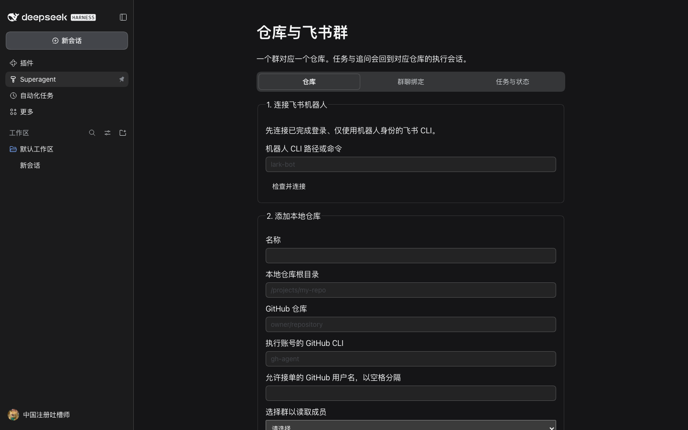
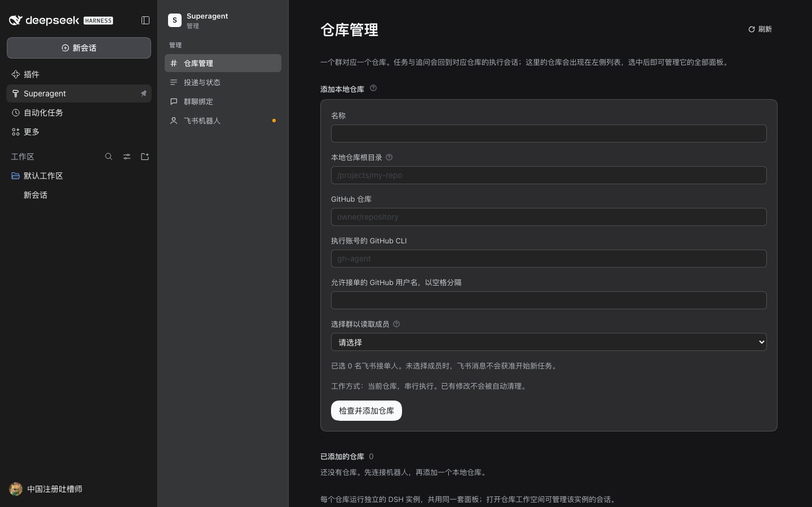
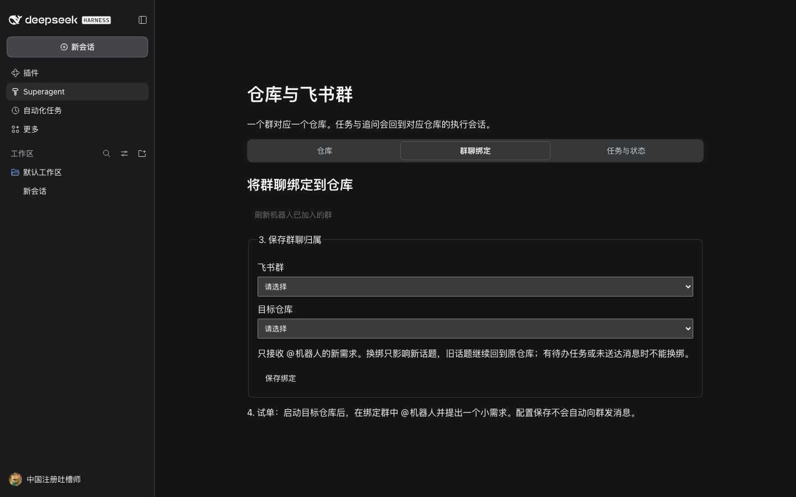
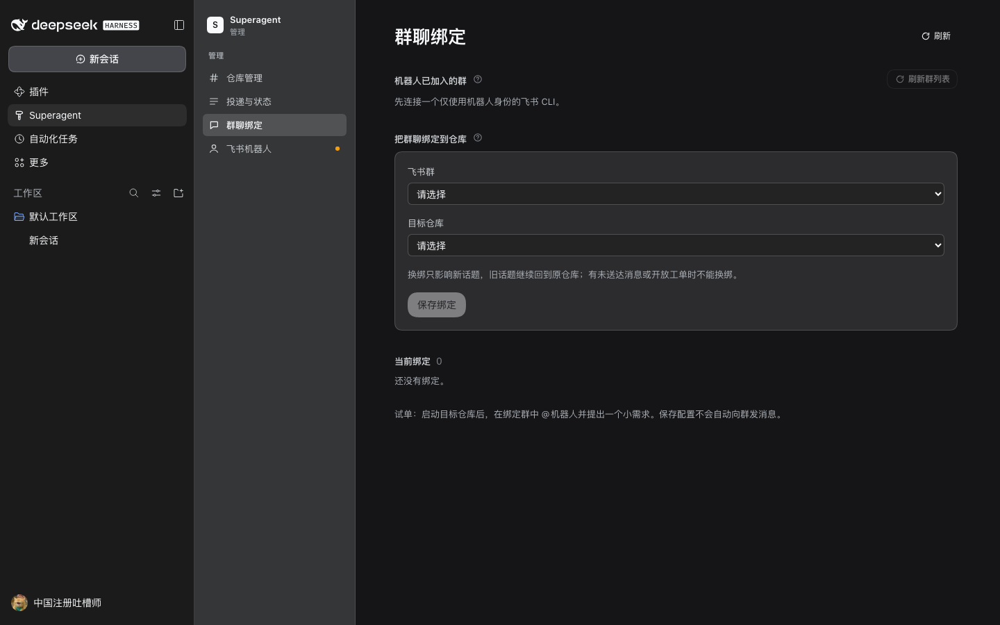
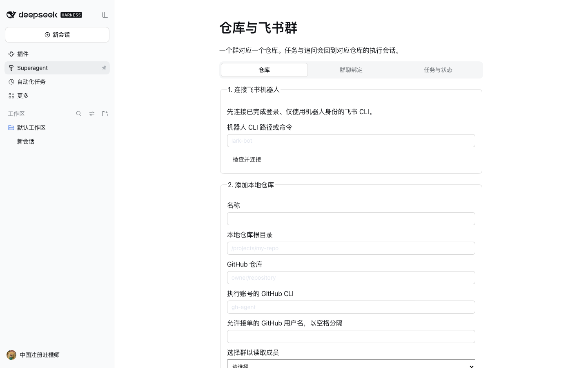
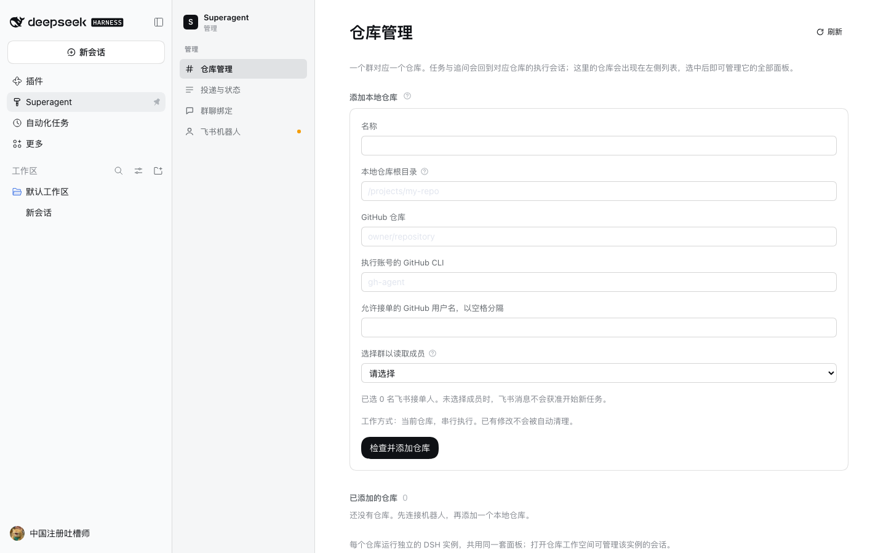
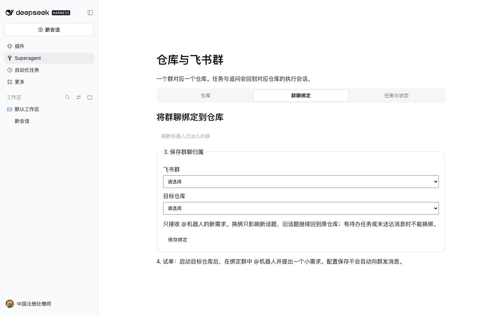
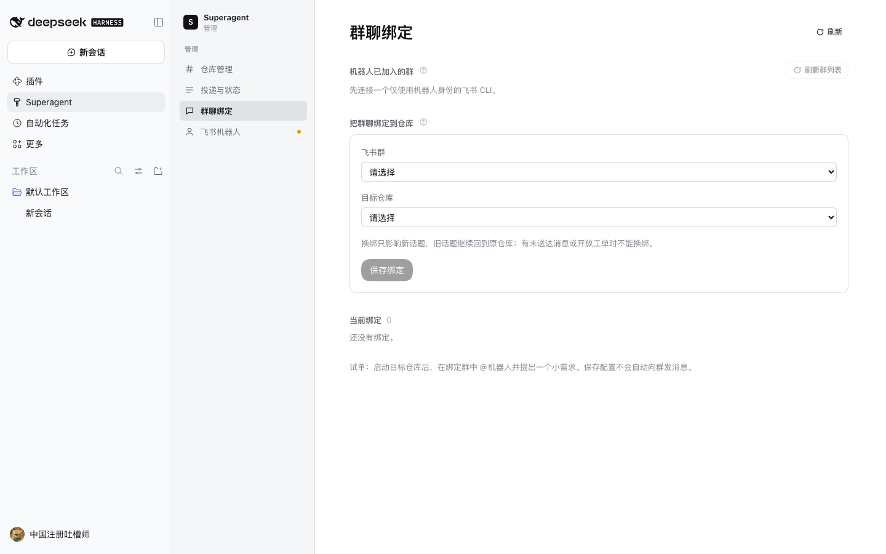

# Manager mode in the unified panel: before and after

Evidence for merging manager mode into the Superagent panel: manager pages now use the same left rail and detail column
as a standalone deployment, and a selected repository opens its own panel areas in that rail instead of a second product
with page tabs.

## Scenario

Both revisions were captured from the same scratch DeepSeek Harness deployment in manager mode at `1440 × 900`, interface
language `zh-CN`, with the same empty manager state (no bot connected and no repository registered). The panel is opened
from the DSH sidebar; the theme comes from `prefers-color-scheme`.

| Comparison | Before | After |
| --- | --- | --- |
| Dark theme, Repositories |  |  |
| Dark theme, Group bindings |  |  |
| Light theme, Repositories |  |  |
| Light theme, Group bindings |  |  |

## What changed

- The manager's three horizontal page tabs are gone. The control pages are rail items grouped under **Manager**, next to
  the registered repositories, and each page is one headed detail column.
- The control pages keep every existing option: bot connection, repository registration and access editing, start/stop
  and open workspace, group binding and its enable switch, delivery backlog, health and per-repository task actions.
- A registered repository appears in the rail. Selecting it keeps the manager's groups and adds that repository's own
  Workspace, Flow and Configuration areas, so Inbox through Settings are the same pages as in a standalone deployment.
- Those repository pages read and write through the manager's authenticated proxy to the repository's isolated DSH
  instance; the browser never receives the instance token. Session buttons open that repository's workspace, because the
  Session lives in the instance's own DSH home.

## Reproduction

The captures used a throwaway DSH home with a profile that links this package in manager mode (`mode: manager`, an empty
`stateDir`) and runs `dsh --profile <name> --no-open`, then a headless Chromium session that opened the Superagent panel.
The baseline is `54093ef` (the head of #3, where this manager page was unchanged); the after revision is the head of the
pull request that introduced this directory.

The captures cover the manager control plane with no repository registered. A repository's own pages are the same panel
components in both deployments and are exercised through the manager proxy by `tests/panel-manager.spec.tsx` and
`tests/manager-runtime.spec.ts`.
